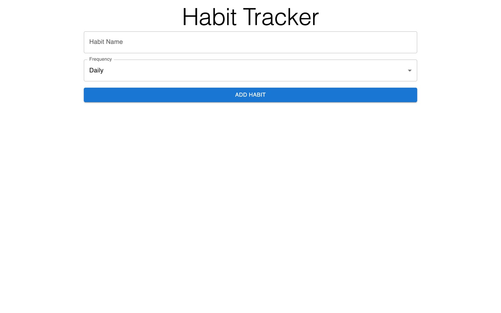

<div align="center">

# 📆 Habit Tracker

A typed habit tracker built with React, Redux Toolkit and Material UI.

<a href="https://miladmo68.github.io/Habit-Tracker/"></a>
<a href="https://github.com/miladmo68/Habit-Tracker"></a>
<a href="https://miladweb.com"></a>

**🔗 Live:** [miladmo68.github.io/Habit-Tracker](https://miladmo68.github.io/Habit-Tracker/)

</div>

<p align="center">
  
</p>

## ✨ Features

- Add daily or weekly habits
- Mark habits complete
- Progress statistics

## 🛠️ Tech Stack

     

## 🚀 Getting Started

**Prerequisites:** [Node.js](https://nodejs.org/) 18 or newer

**Install and run**

```bash
git clone https://github.com/miladmo68/Habit-Tracker.git
cd Habit-Tracker
npm install
npm run dev
```

## 📁 Project Structure

```
Habit-Tracker/
├── public/
├── src/
├── eslint.config.js
├── index.html
├── package.json
├── tsconfig.app.json
├── tsconfig.json
├── tsconfig.node.json
└── vite.config.ts
```

## 👤 Author

**Milad Mohammadi** — Frontend-Focused Full-Stack Developer, Toronto 🇨🇦

[](https://miladweb.com)
[](https://www.linkedin.com/in/miladmo68/)
[](https://github.com/miladmo68)

<p align="center"><sub>If you like this project, consider giving it a ⭐</sub></p>
